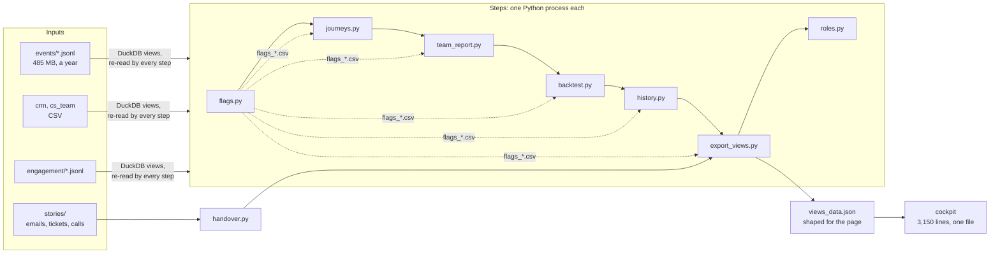

# Architecture review (13 Nov 2026)

The project grew a feature at a time for five weeks. This page looks at the shape
it ended up with, names the places where that growth now costs us, and decides what
to fix before Phase 9 (RAG and MCP) and what to leave. Each fix is marked **Do now**,
**Later** (with the trigger) or **Not worth it**, with the reason, like AI_COST.md.

## The shape today

What works and should stay: SQL in DuckDB computes the facts; one `connect()` defines
the views once; settings hold every threshold; 28 test files (about 5,800 lines) catch
regressions; the AWS side is all code, least privilege, with its own tests.

## What the growth costs us

1. **Every step re-reads every event.** The views are views, not tables, so each of
   about nine steps parses the same 485 MB of JSON again. The AWS run takes 500 to
   600 of its 900 seconds. One more heavy step (search, extraction) and runs start
   failing. Measured on the run of 13 Nov 2026 (502 s, with the three briefs):

   | Step | Seconds | Share |
   |---|---|---|
   | flags.py | 158 | 31% |
   | backtest.py | 60 | 12% |
   | export_views.py, twice | 55 | 11% |
   | handover.py (the model, only on request) | 52 | 10% |
   | history.py | 46 | 9% |
   | journeys, team report, onboarding, roles, parquet | 30 | 6% |
   | Outside the steps: 631 input files in, outputs out | 101 | 20% |

   The heaviest step is flags.py, not history.py as this page first guessed. flags,
   backtest, history and export all rebuild 30-day utilisation for every day from raw
   events: about 320 seconds of the same work. The 101 seconds outside the steps are
   the daily event files, one per day, copied one by one.
2. **Steps talk through CSV files with hard-coded paths.** `data/flags_churn.csv` is
   written by one step and read by five others, by a path typed into their SQL. The
   order only lives in two lists that must agree: `run_all.ps1` and `[aws] engine_steps`.
   They already differ (retention.py is in one only).
3. **Rules leak into the page.** "Called" lived in JavaScript as well as SQL, and the
   two disagreed until #150. The page still computes a few rules itself: medians,
   what "planned" and "overdue" mean, the forecast gap. Some of that is right (it
   needs the decisions people save in the page), but each rule should be written once.
4. **One export, shaped for one page.** `views_data.json` answers the cockpit's
   questions. The MCP server and the Ask box will ask different ones ("this account",
   "at risk in Sophie's team"). Without a shared layer, each would rebuild the logic.
5. **Unstructured data has no home.** handover.py reads emails, tickets and call notes
   its own way. Search and MCP would be the second and third way.
6. **Scripts are built three ways.** Some run on import (journeys, export_views, qbr,
   actions), some have `add_views` + `main()`. Only the second kind can be reused
   by a server.
7. **CLAUDE.md is a changelog.** 82 KB, read at the start of every session. It tells
   what happened and when, and it's weak at showing the shape at a glance.

## Decisions

| # | Fix | Decision | Why |
|---|---|---|---|
| A | **Built 13 Nov 2026: the events store.** ingest.py reads the events once into one typed Parquet file (51 MB for 1.85 million events); connect() reads it whenever it was built from the very same input files, else the JSON (never stale). In the sandbox: flags.py 80 s to 7 s, backtest 23 s to 4 s, journeys 9 s to 2 s; history and export unchanged (their time is their own SQL, not reading). Outputs identical; one real find on the way: history's CSVs were sorted with ties, so their row order could change between runs (now ORDER BY ALL). The daily roll-ups wait for the AWS numbers. Original plan: **One database per run.** A first step loads the inputs into a DuckDB file as tables, with a daily roll-up per account (volume, active users, product events) and the 30-day utilisation for every day, computed once. Every later step reads the file. | **Do now** | Fixes 1, and is the foundation for the rest. Target: the four heavy steps (about 320 s) under 100 s. Safety net: the flag files and the export must come out identical, byte for byte. |
| A2 | **Events uploaded as Parquet**, a few files instead of one per day (the planner's Phase 6 item). | **Later**: when the run nears its limit again | The 101 s outside the steps. It changes upload.py and the check Lambda, so it waits until A has shown how much room we gained. |
| B | **Built 13 Nov 2026, re-scoped:** with A done, B is about consistency, not speed, and shared tables would mean one database file opened by several processes (file locks on Windows). Instead: every hand-off file has a name in settings.toml [outputs] (`output_file` / `out_sql`), and one [pipeline] list feeds run_all and the Lambda. Outputs identical; one more find: qbr.py's packs came out in a different order run to run (ties in the sort, now broken). Original plan: **Steps share tables, not hand-typed paths.** Flags, journeys and values become tables in that database; the CSVs stay as exports for people and Athena. One pipeline list in settings, read by run_all and the Lambda. | **Do now**, with A | Fixes 2. Same test: identical outputs. |
| C | **Built 13 Nov 2026:** facts.py; export_views.py builds the cockpit from it (views_data.json identical, byte for byte); account, at_risk, timeline and tasks for the next readers, each tested against the cockpit's own numbers. Original plan: **A facts layer.** One module (`facts.py`) with the questions the product answers: an account, the at-risk list for a segment, a timeline, the task queue. export_views, the MCP server and the Ask box all call it. | **Do now** | Fixes 4. Phase 9 needs it, so building it first avoids building it twice. |
| D | **Built 13 Nov 2026:** documents.py; handover.py reads only through it (what the model sees, byte for byte the same); a DuckDB table for search. Original plan: **One documents table.** Emails, tickets and call notes in one shape: account, source, date, author label, text. Redaction keys stay out of it, local only. handover.py reads it too. | **Do now** | Fixes 5. Search, MCP and the brief share one way to read documents. The privacy tests must pass unchanged. |
| E | **Rules out of the page.** Each business rule computed by SQL and exported ("called", "planned", the medians). The page keeps only the rules that need saved decisions, with their thresholds from settings. | **Later**, tab by tab | Fixes 3. Do it whenever a tab is touched; the "called" fix showed the pattern. Not worth a big-bang pass. |
| F | **Every script as `add_views` + `main()`.** | **Later**, when a script is touched | Fixes 6. The facts layer only needs the ones it calls. |
| G | **Built 13 Nov 2026:** CLAUDE.md from 86 KB to 19 KB: rules, testing as a table, the business logic, the shape of one run and a one-line map; every file's full entry moved word for word to REFERENCE.md (nothing lost), the dated history with it. Original plan: **A short CLAUDE.md.** Working rules, the shape, the map of files in a line each. The history moves to the PRs and a dated log. | **Do now**, cheap | Fixes 7. Every session reads less and sees more. |
| H | **Split the cockpit into files.** | **Later**: when the Ask box is built | It hurts, but it's tested (208 checks) and works. Splitting adds no value until a new kind of feature needs it. |
| I | Replace DuckDB, move to a server database, a front-end framework, or Step Functions. | **Not worth it** | Our scale is 500 accounts. DuckDB on one file handles that easily, and the laptop and AWS run the same SQL. Each of these would be a rebuild for no user-visible gain. |
| J | Rewrite the data generator. | **Not worth it** | It's long, but it's a demo tool with tests behind it. It changes when the story changes. |

## Order

1. Measure: done 13 Nov 2026 (the table above).
2. A + B in one PR: the database file, tables between steps, one pipeline list.
   Identical outputs, then the new step times.
3. C + D: the facts layer and the documents table, export_views and handover.py
   moved onto them, outputs and privacy tests unchanged.
4. G: CLAUDE.md slimmed.
5. Then Phase 9 starts on top: account search reads the documents table, the MCP
   server calls the facts layer.

Each step keeps every test green and changes nothing a user can see, except speed.

# Second review (25 Nov 2026)

Twelve days and about 100 PRs after the first review: Phase 9 (search, redaction, two MCP
servers, ask.py, vectors), two years of data, data missing and growth. Same format: each
finding gets **Do now**, **Later** (with the trigger), **Not worth it**, or **Nikodem to
decide**. The README's two diagrams were redrawn with it (they were 12 days behind).

## What changed in the shape

- **Four ways in from the internet, not one:** Slack's clicks, the public site, its
  search (GET /search) and the public MCP server (POST /mcp). Each is throttled at the
  gateway, and the search function can't read the data bucket, a key or a secret.
- **Two model providers:** the Claude API for text (briefs, ask.py), Bedrock Titan for
  vectors (embed.py on the laptop, and each public search question). Bedrock's Claude quota
  was declined twice, so this is a workaround, not a choice.
- **The laptop does more:** embeddings, the redacted search file, the local MCP server and
  Slack's task cards all start there.
- The first review's foundations held: the events store (A), the named hand-off files and
  one step list (B), facts.py (C) and documents.py (D) carried all of Phase 9 without a rebuild.

## Measured

The engine in the sandbox today, by step (seconds, store already built):

| Step | Seconds | Share |
|---|---|---|
| history.py | 105 | 60% |
| flags.py | 28 | 16% |
| export_views.py, twice | 29 | 17% |
| backtest.py | 9 | 5% |
| the other seven | 18 | 10% |

On the laptop, history took 146 seconds on 25 Nov. The last AWS timing is the first
review's: 502 seconds on 13 Nov with three briefs, history 46 of them. Since then the store
(A) took most of flags' time away, but the data doubled to two years and growth is replayed
every week. **We don't know today's AWS run time.** The limit is 900 seconds.

| Size | 13 Nov | 25 Nov |
|---|---|---|
| The cockpit template | 3,150 lines | 4,853 lines |
| The cockpit page | about 1.5 MB (one year of data) | 2.0 MB (two years, the page cut to the last year) |
| Test files | 28 | 53 (about 10,000 lines) |
| CLAUDE.md | 19 KB after G | 27 KB, 26 KB after this review |

## Findings and decisions

| # | Finding | Decision | Why |
|---|---|---|---|
| K | **History is the new bottleneck.** It replays the flags every week for two years (92 replays) from scratch; the page shows only the last 53. Growth made each replay heavier (churn is now materialised once a week to hold it at 105 s, not 231 s). | **Do now: measure** the AWS run (run.json's step_seconds) after the next deploy. **Later**, when AWS's history passes 300 s or the run 600 s: replay only the page's weeks on a daily run, and the full two years on a regenerate (the hero test and Athena need them). | A guess at AWS's time is how the first review got the bottleneck wrong (it named history; it was flags). Measure, then cut. The cut is cheap and keeps the outputs identical on a regenerate. |
| L | **export_views.py runs twice** (about 15 s each): the second only picks up handover's "brief out of date" marks, because handover reads the first export. | **Not worth it** until K's trigger | 8% of the run. If time gets tight, a handovers-only export takes it to about 1 s. |
| M | **A rule went into the page again.** Growth's "addressed" (a meeting or a next step since the signal began) is JavaScript only (addressedIn, 25 Nov). The rule is consistent on every tab, but the MCP servers and the Ask box can't answer "is this growth addressed?". "Planned", "overdue" and the forecast gap are the same (fix E). | **Later: with the Ask box**, its first reader. facts.py gets `addressed` and the page reads it from the export. | The decisions it needs already come back as events (cockpit_sync.py), so SQL can compute it. The Ask box is the trigger E was waiting for. |
| N | **The cockpit grew 54% in 12 days** to 4,853 lines in one file. Fix H's trigger, the Ask box, is next. | **Do next, before the Ask box:** split the template into a few source files (styles, shared helpers, one per tab) that export_views.py joins into the same one page. | The output stays one file, so the public site, the tests and roles.py don't change. Only the editing gets easier, and the Ask box arrives as its own file. |
| O | **Admin as a separate microservice?** (Nikodem's question.) Today the admin works from the laptop (request_briefs.py, put_key.py). | **Decided 25 Nov 2026 (Nikodem: "by default, there could be a separation of function"):** the admin side is its own Lambda function, in its own stack of the same CDK app (deployable on its own, `cdk deploy` of that stack), behind sign-in (Cognito), with its own role. It shares nothing with the engine by default; each link is one explicit permission: start the engine with briefs, read the spend ledger. Built with the Ask box. | What a separate service would give, a smaller blast radius, comes from its own role and route. What it costs: a second pipeline, a contract between stacks to keep in step, and no gain a user sees at 500 accounts. Split a service off when a different team owns it. |
| P | **Four ways in** (see above). | **No change** | THREAT_MODEL.md covers each (ways in 1 to 10, threats 23 and 25), with tests. The only model cost a stranger can cause is Titan per search question: throttled, cached and with a kill switch. |
| Q | **The docs drifted.** The README's diagram was 12 days behind; CLAUDE.md grew back to 27 KB, mostly a changelog in "Planned next". | **Done in this review:** the diagrams redrawn, "Planned next" trimmed (the detail moved word for word to REFERENCE.md), and a rule in CLAUDE.md's map: a new AWS resource or way in updates the README's diagrams in the same PR. | Fix G's lesson again: the short page stays short only if something stops it from growing. |
| R | **Two providers, and the laptop as a second control plane** (embeddings, Slack cards, the local MCP server). | **Not worth it** for the demo | Bedrock Claude would make it one provider: the code is ready, the quota isn't. Moving actions.py into AWS is what a real deployment needs (README, honest limits), not the demo. |

## Order

1. Deploy what's merged and read AWS's step times (K).
2. O decided (25 Nov 2026): the admin function in its own stack, built with the Ask box.
3. N: split the cockpit's source, the page byte for byte the same.
4. The Ask box, with M (addressed in facts.py) and, if O says so, the admin Lambda.
