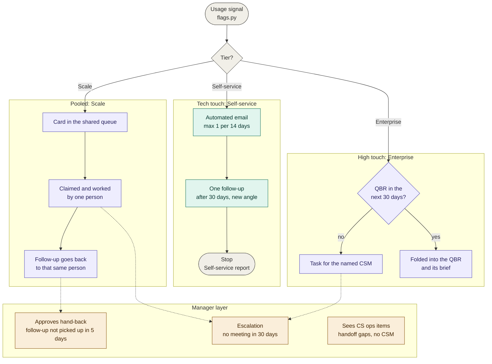
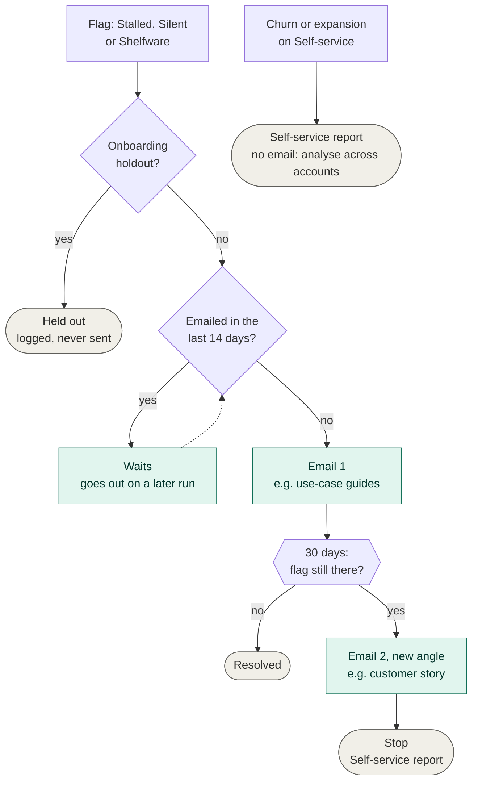
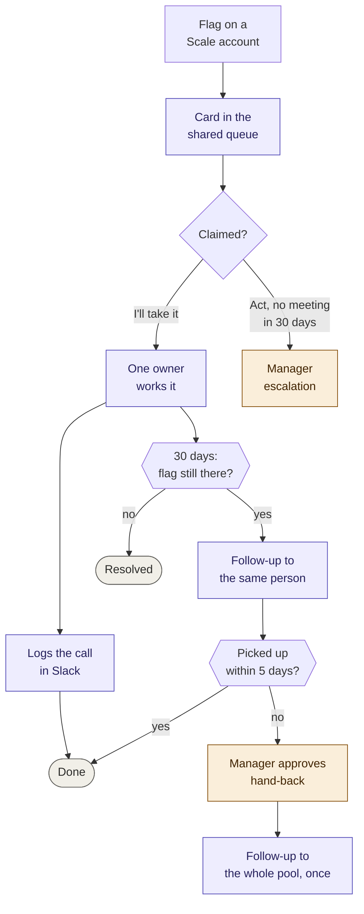
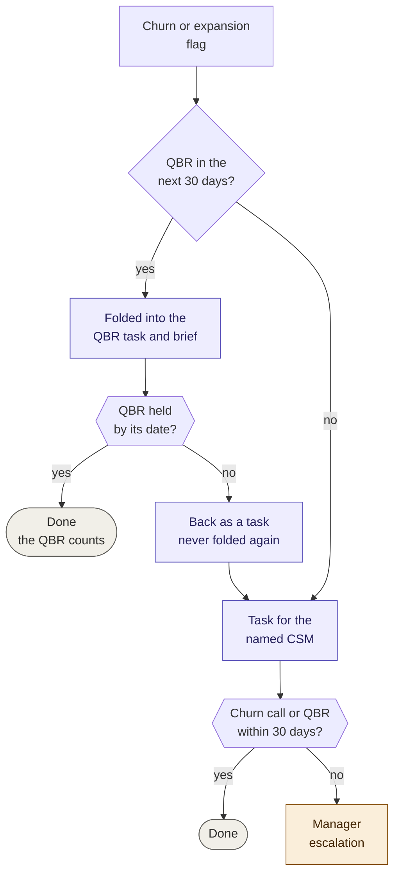
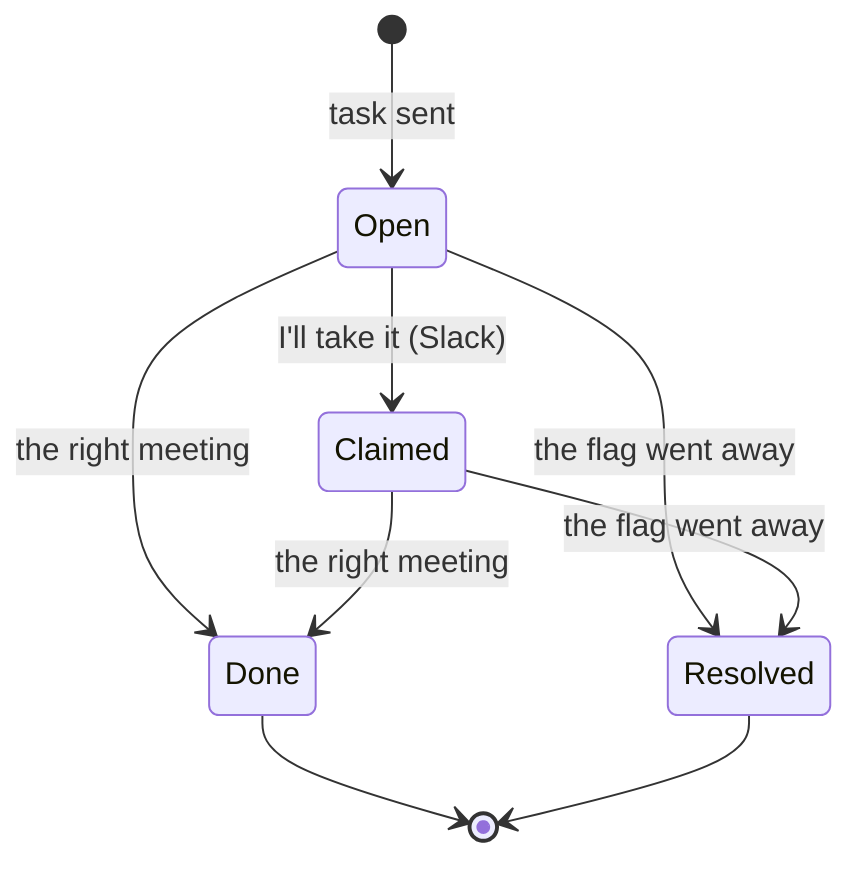

# Engagement logic by tier

**The automation spots the moment; the right person acts on it.** The same
signal is handled three ways, depending on how much human coverage the account
has, and every step has a time limit so nothing waits for ever.

The diagrams follow two conventions from customer success tooling: one lane per
coverage tier (tech touch, pooled, named CSM), and journey flows where a timed
check ("30 days: is the flag still there?") decides the next step, as in
Gainsight's Journey Orchestrator programs. Hexagons are those timed checks;
diamonds are plain yes/no decisions.

Colours: green = automated, purple = a CS person acts, amber = a manager
decides, grey = end state.

## 1. Who covers what

| Tier | Touch model | Coverage | Who acts on a flag | Where it lands | Safety net |
| --- | --- | --- | --- | --- | --- |
| Self-service (300) | Tech touch | No CSM | Automation | Simulated email (#email-preview) | One follow-up, then the Self-service report |
| Scale (150) | Pooled | One team per region | Whoever claims it | Shared queue (Slack cards) | Manager sees unclaimed tasks; approves hand-backs |
| Enterprise (48) | High touch | Named CSM, 8 accounts each | The account's CSM | The CSM's own task | QBR first; manager escalation |

## 2. Overview

## 3. Self-service: tech touch, one follow-up, then stop

Automated, so the guard rails are about the customer's inbox: the onboarding
control group never gets the programme, no account gets more than one
automated email in 14 days, and each issue gets two touches at most.

## 4. Scale: a shared queue, with ownership that sticks

Anyone in the regional pool can pick a task up, which spreads the load and
avoids peaks and troughs. Once someone has taken it, the follow-up comes back
to them, so the customer hears from the same person. If that person can't pick
it up (holiday, left, swamped), the manager decides: a person, not a timer.

## 5. Enterprise: QBR first, but only once

A named CSM owns the account. If a QBR is booked in the next 30 days, the
churn or expansion flag goes into the QBR brief instead of becoming a separate
task, and the QBR counts as the action. If the QBR doesn't happen, the flag
comes back as a task, and it is never handed to a QBR again: a customer who
keeps moving the QBR can't park a problem for months.

A routine check-in never closes a churn task: the problem has to be raised in
a churn call or the QBR.

## 6. What "done" means: action status

The action log records that a task was sent. The status says what happened
since, worked out from the data, so nobody has to tick a box.

| Flag | Counts as Done |
| --- | --- |
| Churn | A churn call or the QBR (not a check-in) |
| Expansion | A growth call or the QBR |
| QBR | The QBR |
| Activation, escalations | Any meeting |
| CS ops (handoff gap, no CSM) | Only Resolved: the CRM record is fixed |
| Manager hand-back approval | The manager clicks "Approve hand-back" |

All the numbers above (14, 30 and 5 days) live in `settings.toml`.
