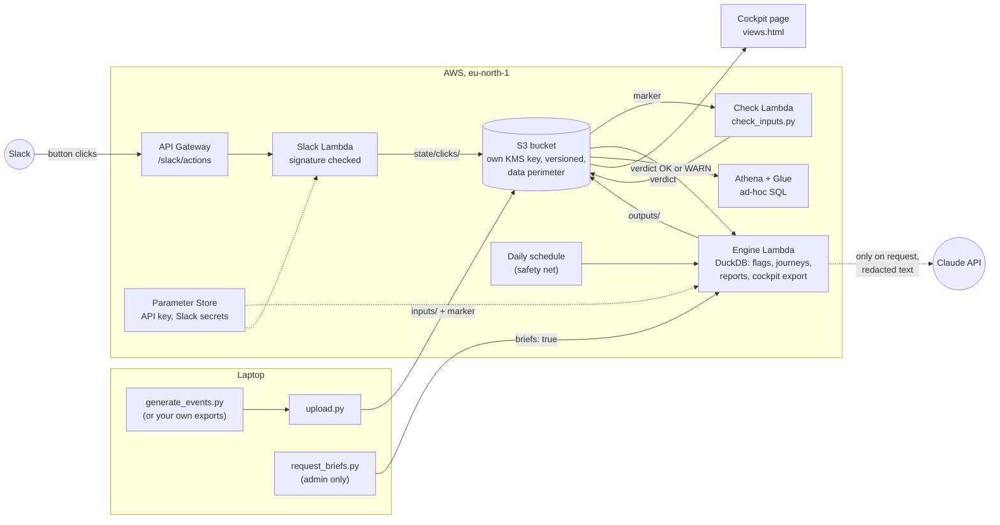

# Cairnpath engagement engine

**A sandbox for designing a Customer Success operating model that scales.**

Every CS leader asks the same question: *am I using the people I have to get
the best results?* Most can't answer it. The CRM was built for sales: it knows
contracts and opportunities, not how customers use the product or what CS did
about it.

This engine answers it. Product usage and CS activity go in. Out come flags
that say which accounts need attention, why, and who should act, and a check
of whether acting worked.

**Try it on simulated data, then replay it on your own history.** The demo runs
on about 500 generated customers of Cairnpath, a fictional product analytics
SaaS. Point it at your own CRM, team and usage exports and the same rules run
on your book, on your laptop: your files never leave it.

**A template, not a platform.** Coverage models (self-service, pooled, named
CSM), routing, thresholds and who sees what all live in one settings file.
Change the operating model by editing settings, not code, and see what it does
to the work before you change the team.

What a CS team gets:

- **A page per person.** A CSM sees her book, a manager his team's queue, the
  leader the whole book. Each page holds only what that role may see.
- **People where they count.** Automation takes the many accounts that only
  need a nudge; people get the ones that need a conversation.
- **Nothing on trust.** Every flag shows its numbers, and every number clicks
  through to the accounts behind it.
- **"Did it work?"** The flags are tested against what happened at renewal:
  what they caught, what they missed, how much warning they gave.

It doesn't replace CSMs. It's an engagement funnel, measured at every stage:
signal (flags), task (actions), action taken (time to action), outcome at
renewal (backtest).

Below: what it does, how it's built, and how it's secured and tested. The
technical depth is the proof.

## What it does today

| Flag | Looks for | Who acts |
| --- | --- | --- |
| Activation | New customers who are activated, stalled or silent, plus gaps in our own records (no CRM entry, no CSM assigned) | Automation, regional pools, named CSMs, CS ops |
| Churn risk | Utilisation falling for two months, weekly active users dropping, and rising ingestion errors as a sign of a technical cause; plus Shelfware: live 60+ days and never above 40% utilisation (the rollout never happened) | Same routing, with Watch and Act levels; Shelfware asks for an adoption review (Self-service: a use-case inspiration email) |
| Expansion | Accounts heading over their contract with a growing team, plus volume rising without users (often over-tracking) | CSMs and pools investigate and build the growth case; Sales only signs |
| QBR | Enterprise QBRs in the next 30 days (with a facts pack per account) and QBRs overdue with nothing booked | Named CSMs |

Every flag shows the numbers behind it (for example *"Utilisation 52%, then
39%, then 27%"*), who it is routed to and what to do next.

On top of the flags: a **cockpit** (one HTML page, nine tabs: leadership
one-pager, each owner's morning page, the manager's task queue, account
timelines, "did it work?"), **Slack task cards** with buttons that flow back as
CS history, and two **AI features**, both privacy-first: a one-page QBR brief
and a handover brief for a new account owner, written from support cases,
emails and call transcripts, every claim cited and checked.

## Architecture

It runs in two places with the same code: a laptop (Windows, `run_all.ps1`) and
AWS (eu-north-1, all of it as code in [`infra/`](infra/), CDK in Python).



**One run, step by step.**
1. `upload.py` sends only new or changed input files, then a small marker file.
2. The marker wakes the **check Lambda**: missing columns, bad dates, unknown
   tiers. ERROR stops everything downstream (the gate).
3. The check's verdict wakes the **engine Lambda**: it pulls the inputs, the
   action log and the Slack clicks, runs the same scripts as the laptop
   (flags, journeys, team report, backtest, onboarding, cockpit export), checks
   for free whether each AI brief is out of date, and writes Parquet tables for
   Athena. `run.json` is written last, so whoever reads it sees a finished run.
4. A **daily schedule** reruns the engine only if a run was missed or failed,
   or Slack clicks came in since.
5. **Slack clicks** ("I'll take it", "Log call") go to their own small Lambda
   behind API Gateway and become CS history on the next run.
6. **AI briefs** are written only when the admin asks (`request_briefs.py`).
   Nothing a user clicks, uploads or saves can make the model run.

## Run it

Windows / PowerShell, from the repo root. The quick way, after the one-time
setup below: `.\run_all.ps1` pulls the latest code and runs everything in
order (`-Regenerate` for fresh data, `-Actions` to post to Slack); the output
goes to `data\last_run.txt`. Step by step:

```
python -m venv .venv
.venv\Scripts\Activate.ps1
python -m pip install -r requirements.txt
python generate_events.py   # ~500 accounts, 90 days of events
python check_inputs.py      # are the inputs complete? what will and won't work
# your own data instead of the fake one: see "Running on your own data" in DATA_CONTRACT.md
python explore.py           # the book of business at a glance
python flags.py             # activation, churn, expansion and QBR flags, plus work queues
python check_flags.py       # test the flags against the generator's answer key
python backtest.py          # did the flags see churn coming? recall, precision, warning time
python journeys.py          # follow-ups based on the last CS touch (unopened emails, no meeting in 30 days)
python team_report.py       # how fast each CSM and pool acts on churn and expansion Act accounts
python onboarding_report.py # does the getting-started email help? welcomed vs. control group
python export_views.py      # the views page: open data/views.html in a browser
node tests/cockpit_test.js  # optional: tests the cockpit in a headless browser (needs Node + Playwright)
node tests/scenarios_test.js # optional: the 23 acceptance scenarios by role, automated
python actions.py           # tasks to Slack: digests, plus cards with buttons for the demo owners
python listener.py          # in a second window: handles the buttons; clicks flow back as events
python qbr.py               # facts pack for each QBR in the next 30 days
python brief.py             # LLM-written QBR brief per pack (Bedrock: run aws login --profile cairnpath first;
                            #   or provider = "anthropic" in settings.toml with ANTHROPIC_API_KEY in .env)
python handover.py          # AI handover brief from support cases, emails and calls (--dry-run: no model;
                            #   rewrites only when the context changed, --force to rewrite anyway)
python tests/handover_test.py # privacy: no real name, email or phone reaches the model; then brief quality
```

To tune the engine, edit `settings.toml` (every threshold and time window,
with a comment on each), then rerun `flags.py` and `check_flags.py`.

In AWS (after `aws login --profile cairnpath`; deploying is in
[infra/README.md](infra/README.md)):

```
python upload.py            # new or changed inputs to the bucket; the check and the engine run by themselves
python request_briefs.py    # the AI handover briefs, only when you ask (changed ones only, within budget)
python security_check.py    # live: 39 questions on what each deployed role can and can't do
python access_report.py     # anything reachable from outside the account (baseline: 0)
python guardduty_report.py  # threat findings and the cost so far
python llm.py --spend       # this month's AI spend by feature, against its budget
```

## How each tier is handled

[ENGAGEMENT_LOGIC.md](ENGAGEMENT_LOGIC.md) shows the logic as diagrams: who
covers each tier, the Self-service email journey, the Scale shared queue with
its hand-back, Enterprise's QBR-first rule, and what "done" means.

## Running it on your own data

[DATA_CONTRACT.md](DATA_CONTRACT.md) lists the five inputs (events, CRM, CS team,
engagement history, onboarding holdout), their columns, and which flags stop
working when one is missing.

## Security, in one table

Every control is code, and every one has a test. The full list, with what each
leaves open, is in [THREAT_MODEL.md](THREAT_MODEL.md) (16 threats).

| Control | What it stops | Proven by |
| --- | --- | --- |
| One role per job, least privilege | A stolen workload credential doing more than its one job | `security_check.py`: 39 questions to AWS's policy simulator, on what's deployed |
| Data perimeter (bucket policy) | Anyone else in the account, even with `s3:*`, reading or writing the data | `security_check.py` |
| Own KMS key, usable only through S3 | A copied file decrypted outside the bucket's rules | `security_check.py` |
| Public access blocked, HTTPS only, versioned | Exposure, eavesdropping, a bad run you can't undo | `tests/infra_test.py` (87 checks on the template) |
| Slack signature check, rate limit | Forged or replayed clicks, floods | `tests/slack_lambda_test.py` |
| Never trust the page | Bad or forged cockpit decisions; one bad row stopping the pipeline | `tests/cockpit_sync_test.py` |
| Redaction + leak check before the model | People's names, emails or phones reaching the model | `tests/handover_test.py`, `tests/leak_check_test.py` ([PRIVACY.md](PRIVACY.md)) |
| Secrets in `.env` / Parameter Store only; push protection | A key in the code, a log or the public repo | `tests/put_key_test.py`, GitHub push protection |
| IAM Access Analyzer, GuardDuty (trial) | Something reachable from outside; odd activity in the account | `access_report.py` (baseline: 0), `guardduty_report.py` |

No console access for anyone: everything is deployed with `cdk deploy` and read
back with scripts.

## Cost

| What | Cost | Control |
| --- | --- | --- |
| AWS (Lambdas, S3, API Gateway, Athena, KMS key) | About $2 a month | Cost Anomaly Detection emails when a day's spend jumps (from $5); Athena cancels a query scanning over 1 GB |
| GuardDuty | Free trial to about 5 Dec 2026 | Keep-or-switch-off decision on 1 Dec, from weekly reports |
| AI briefs (Claude API) | About 3 cents per handover brief | A budget per feature checked **before** every call ($2 QBR, $3 handover a month); every call in the AI spend ledger (`python llm.py --spend`, Athena table `ai_spend`); briefs only on the admin's request; a cache that rewrites only when the context changed; a $10 limit on the Anthropic account as the ceiling |

AWS's anomaly emails can't see the Anthropic bill, which is why the AI spend has
its own ledger and budgets.

## Design choices

- **SQL computes the facts; the LLM only writes them up.** The model gets a
  facts pack with pseudonymised users, never raw data. Every number in its
  draft is checked against the pack, and anything it can't trace is listed
  as "unverified" for the CSM to check. Real user IDs go back in afterwards,
  outside the model.
- **Every alert explains itself** and comes with an action. Alerts that only
  show a score get ignored.
- **Actions happen once only.** Flags are raised again on every run, so
  `actions.py` checks an action log before doing anything and records what
  it did. A daily run never emails the same customer twice, and facts the
  pipeline creates ("welcome sent") stay out of the CRM.
- **The rules are tested against an answer key.** The generator records
  which behaviour it gave each account; `check_flags.py` checks that every
  flag finds the accounts it should and lists each miss and false alarm.
  It caught a 2-person account flagged as churn risk because one user had a
  quiet week ("-48%"), so a drop now has to be at least one whole user.
- **False alarms are treated as a bug.** Rising errors on their own flagged
  41 healthy accounts, so they now only count alongside a usage signal. A
  straight-line forecast flagged 32 healthy accounts as "heading over the
  cap", so forecasts now only count for accounts already at 80% and
  clearly climbing.
- **It's a CSM cockpit, not an org-wide tool.** Customer messaging triggered
  by usage or plan limits belongs to Product. When a utilisation flag fires,
  the CS job is to investigate and analyse, so churn and expansion never
  email customers; Self-service rows go to a report for pattern analysis.
- **Automation supplements CSMs; it doesn't replace them.** Rules catch the
  long tail across hundreds of accounts. They will always miss edge cases:
  healthy accounts that dip, and churners that look fine until they leave.
  Catching more of those is a constant effort as CS scales, and it's the
  main reason the top tier keeps a named CSM, whose judgement covers what
  the signals miss.
- **AI runs only when a person with the right role asks.** Background
  automation does the free work (flags, reports, "this brief is out of date");
  anything that costs money waits for the admin. The trade-off: briefs can go
  stale, and the cockpit says so.
- **Default deny, for money too.** An AI feature without a budget in
  settings is refused, so a new feature can't be added without a limit.
- **Identity over network.** No VPC or NAT gateway: identity and policies check
  every call, and the NAT alone would cost more than the whole project.
  Accepted, written down, revisitable.


## Honest limits of the demo

The data is generated with clear account "personalities", so good and bad
accounts separate more cleanly than in real life. The flags look more
accurate here than they would on real customer data.

What a real deployment would add: sign-in for the cockpit (SSO) with each login
mapped to an owner, the workloads moved out of the management account, the
model on Amazon Bedrock (the code is ready; the account's quota isn't yet), and
a monthly reconciliation of the AI ledger against the provider's bill.
